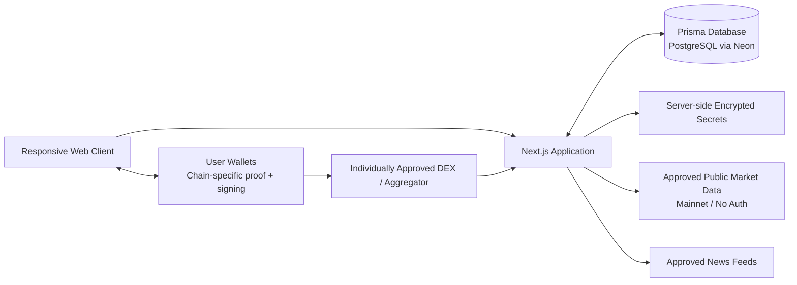
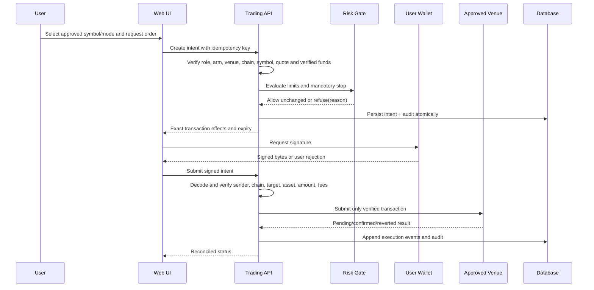

# Veylora System Architecture — Phase 2 Draft

**Status: current architecture.** Private GitHub and Vercel publication are authorized; Cloudflare was skipped. Production cutover and deletion of old deployments wait on a working database migration and runtime checks.

## System context

The browser owns wallet connection and transaction signing. EIP-4361/SIWE is the confirmed EVM authentication method; it does not prove control of a Solana address. Any non-EVM wallet identity needs a chain-appropriate proof and explicit design/user approval before use. The server may validate and record a user-authorized intent and submit only the exact signed bytes when that flow is approved; it must never receive a seed phrase or private key. All integration edges are disabled until their exact provider/venue/chain/endpoint is approved.

## Application boundaries

- **Web/presentation:** Next.js routes and server-rendered/client components. Render typed states (`connected`, `not_connected`, `loading`, `stale`, `unavailable`, `error`) without substituting zero or plausible values for missing financial data. Client state is not authority for role, balance, risk or approval.
- **Authentication and authorization:** SIWE nonce issuance/verification for EVM identities, session creation/revocation, role resolution and MFA checks. Any additional chain's wallet-link proof is separately specified and verified; an EVM session alone does not prove control of another chain's address. Server handlers re-authorize each request; admin is never self-assigned. Initial admin bootstrap remains locked pending the user-provided wallet.
- **Market-data service:** provider-neutral interface for quotes, order books, candles, announcements and RSS. Each normalized observation carries provider, instrument, market/chain, source timestamp, fetched timestamp, freshness classification and raw-response provenance reference/hash. Provider failures remain failures; no signal or price fallback is fabricated.
- **Portfolio and ledger:** portfolio reads derive from verified provider responses and confirmed recorded events. Ledger writes are atomic/idempotent and source-linked. Imported holdings and strategy estimates are never treated as verified funds.
- **Strategy service:** deterministic configuration validation and signal generation over real timestamped inputs. LLM output, if later approved, is advisory input only and cannot alter risk limits, authorize symbols, arm trading or issue a transaction.
- **Risk service:** pure deterministic `allow | refuse(reason)` gate immediately before intent creation/signing. It allows only the exact requested order when every rule passes; otherwise it refuses. It never resizes, creates or enlarges an order, notional, leverage or exposure.
- **Trading orchestration:** constructs an immutable order intent, requests quote/simulation, runs risk checks, presents exact transaction effects, requests wallet signature and reconciles pending/submitted/confirmed/reverted/failed states. Chain and contract allow-lists are server-owned and disabled by default.
- **Support/admin:** ticket and customer workflows share authenticated role checks and append-only audit events. Admin console remains locked until bootstrap is complete.
- **Background work:** scheduled market refresh, news ingestion and strategy evaluation use idempotent jobs and bounded retries. No background job may bypass live-arm, symbol, risk or venue gates.

## Trust boundaries

1. **Untrusted browser inputs:** validate schemas, ownership, symbol/chain allow-lists and idempotency. Never trust client-supplied balance, price, role, risk result, transaction decode or “approved” boolean.
2. **Wallet boundary:** SIWE proves control only for its EVM address; transaction signing is a distinct per-intent action. A Solana identity requires a separately approved chain-appropriate proof (for example, SIWS); do not infer it from SIWE or equate login with trading authorization. Seed phrases stay with the custodian and never enter Veylora.
3. **Provider boundary:** public feed data can be delayed, malformed or unavailable. Preserve raw timestamps and source identity; do not convert failure to zero or mark stale data live.
4. **Secret boundary:** local `.env` is ignored; production values are server-side. BYO CEX secrets are encrypted at rest with a separately managed key-encryption key, redacted from logs, and never returned after write. API keys start read-only; withdrawal capability is rejected.
5. **Venue boundary:** contracts, routers, tokens, RPCs and quote services are individually approved and allow-listed. No arbitrary destination/calldata. Mainnet assertion tests are mandatory for any enabled adapter.
6. **Persistence boundary:** audit and ledger records are append-only at the application/API layer and protected from update/delete paths. State changes and their audit records commit atomically; audit failure blocks the sensitive action.

## Authentication, sessions and roles

- SIWE/EIP-4361 message includes domain, URI, chain, nonce, issue time and expiration; nonce is single-use, short-lived and consumed atomically.
- Solana wallet linking/authentication is unresolved. If Jupiter/Solana is later approved, choose and review a chain-appropriate proof such as SIWS, bind it to the existing user only after signature verification, and keep it distinct from SIWE session proof. No Solana auth implementation is approved by this draft.
- Sessions are server-authenticated, httpOnly, secure in production, same-site, revocable and rotated on privilege changes. Chain classification is server-validated.
- Roles: `admin`, `trader`, `viewer`. No public/self-service role escalation. Deny by default, check object ownership and role on every write.
- Admin accounts require TOTP or passkey. Admin bootstrap is disabled until the user supplies the initial admin wallet; no seed/private key is collected.
- A wallet may authenticate without arming trading. Arming is per user and explicit; it expires/revokes on security events and never grants a new venue or symbol.

## Market data and freshness

- Initial eligible category: public unauthenticated CEX market data for charts/analytics. This does not enable CEX trading or private account access.
- DEX reads, market-specific feeds, announcements and any paid provider remain disabled until named and approved.
- Normalized quote/candle observations use decimal-safe values and retain both provider event time and local retrieval time. Freshness policy is instrument/timeframe-specific and explicitly approved; unknown freshness renders as unknown.
- Historical candles may be delayed but are labeled with source and period. Store one year only after provider terms/retention approval.
- News items retain original source, published time, fetched time, URL and content hash. No unattributed generated headline is rendered as a feed item.

## Venue candidates and distinct signing flows

The following research shortlist is not an allow-list. Each entry remains disabled until the user separately approves the named venue, chain, endpoints, assets/markets and any contract/router. Source and review details are in `docs/PROJECT_PLAN.md`.

- **Uniswap Trading API — Ethereum Mainnet (1), spot candidate:** `https://trade-api.gateway.uniswap.org/v1` (`/check_approval`, `/quote`, `/swap`, `/order`). The API returns quote data and unsigned transaction data; the user's wallet signs, and Veylora's approved RPC client broadcasts. UniswapX orders use a separate signed-order path. Require a keyed API plan/terms review, explicit router version/address validation, decoded transaction preview, freshness/simulation checks and an independently approved RPC URL.
- **CoW Protocol — Ethereum Mainnet (1), spot candidate:** `https://api.cow.fi/mainnet` (`POST /api/v1/quote`, `POST /api/v1/orders`). The user's wallet signs EIP-712 order data, then the orderbook accepts it for asynchronous solver execution. Model order acceptance separately from fill/settlement; reconcile status, partial fill, expiry, cancellation and on-chain settlement. Do not treat orderbook acceptance as a confirmed trade or balance change.
- **Jupiter Swap API V2 — Solana Mainnet, spot candidate:** `https://api.jup.ag/swap/v2/order` and `/execute`, or `/build` with a separately approved submission provider. The user signs the returned Solana transaction; the recommended meta-aggregator flow sends the signed transaction to Jupiter for broadcast/landing. Record the selected router, fees, expiry and transaction version. Transaction inspection, explicit fee display and user acceptance are required before signing. Resolve official-doc disagreement on API-key requirements and confirm the free-tier/rate-limit terms first.
- The Jupiter/Solana candidate needs a separate wallet-proof/link decision; SIWE/EIP-4361 verifies an EVM address and does not authorize a Solana address.
- **Hyperliquid — HyperCore Mainnet, perpetuals research candidate only:** `https://api.hyperliquid.xyz/info` and `/exchange`. Trading actions are signed by a master wallet or an authorized API/agent wallet, not necessarily by the connected wallet for every order. The documented API wallet can sign for a master account; collateral resides in the venue account, and `/exchange` also supports withdrawals. Do not place this in the default user-wallet execution architecture. It needs a separate custody/account model, withdrawal-scope decision, key lifecycle design and user approval before any connector work.

The three spot candidates do not provide a perpetuals path. Hyperliquid needs a transaction-signing decision, so the Phase 2 design does not yet claim that v1 perpetual execution is implementable.

## Trading and risk sequence

Risk preconditions include configured capital, verified available balance meeting the USD 20-equivalent minimum-trade-balance threshold, per-trade maximum 1%, portfolio exposure maximum 25%, daily-loss halt 2%, mandatory valid stop, user-enabled symbol, default leverage ceiling 1x, max 10 trades/day, admin caps, venue/chain allow-list and arm state. For the first 24 hours after arming, total exposure cannot exceed USD 20. All arithmetic uses decimal-safe units and rejects non-finite, stale or unknown inputs. If a venue cannot guarantee or represent a stop, refuse opening the position; a request above any cap is refused, not silently resized.

The kill switch atomically disables new intents, queues cancellation for open orders and requests position closure; it reports each cancellation/close outcome and audits failures. It does not claim that a close succeeded until confirmed.

## Failure semantics

- Provider failure: mark unavailable/error; retain last observation only as explicitly stale, never as live.
- Missing funds, stop, quote, source timestamp, instrument metadata, allow-list entry, arm or approval: refuse before wallet prompt and audit refusal.
- Wallet rejection: intent becomes rejected/cancelled; no broadcast.
- Timeout after broadcast: `pending_reconciliation`; query only the same approved chain/tx hash and never submit a duplicate intent.
- Database/audit failure: sensitive mutation is rolled back or blocked; never perform a side effect without durable audit intent.
- Kill-switch action failure: keep new-order block active, surface unresolved orders/positions and alert admins.

## Deployment and operations

Prisma now targets PostgreSQL. Neon Free is provisioned and connected to the Vercel project. The existing SQLite database and migration history are retained as migration sources; they are not the active datasource. The local data import, Vercel migration command, and production runtime checks remain pending. Keep secrets in Vercel-managed storage and never commit values. CI must run typecheck, tests, build, secret scan, schema/migration checks, banned-realness-term check and mainnet-URL assertions. No live proof order or real transaction occurs without its own explicit gate and user authorization. Keep existing production and deployment history until the replacement is healthy.