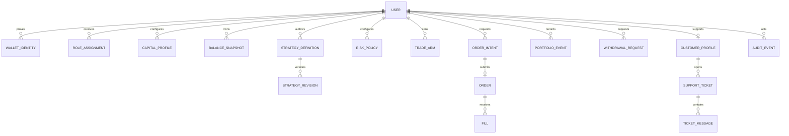

# Veylora Data Model — Phase 2 Draft

**Status: PostgreSQL target.** Prisma targets PostgreSQL. The prior SQLite database and migration history are retained for one-time data transfer and auditability; they are not the active datasource. The production migration and data import are pending.

## Modeling rules

- Prisma is the persistence boundary and PostgreSQL is the active datasource. Use a non-production database or branch locally and the Vercel-managed Neon resource for deployments; use the unpooled URL for migrations. Keep connection values out of source control. The archived SQLite database is only a migration source.
- IDs are opaque UUID/CUID identifiers, never wallet addresses or emails as primary keys. Canonicalize addresses by chain namespace: EVM addresses may use lowercase canonical form with checksummed display form, while case-sensitive encodings such as Solana base58 must be preserved exactly and never lowercased. Wallet identity uniqueness is chain-qualified, not address-only.
- Use Prisma `Decimal` or canonical integer/string units for money, prices, quantities and token amounts; never binary floating point for financial decisions. Store token quantities in raw integer units plus decimals and symbol/address metadata.
- Every external observation stores source/provider, instrument/chain, provider timestamp, fetch timestamp, freshness and provenance. Unknown values are nullable, not coerced to zero.
- User-owned records carry `userId` or `businessId` for row ownership checks. Every write is authorized server-side and emits an append-only audit event.
- Soft deletion may be used for ordinary user-facing records, but never to rewrite or erase retained audit, ledger or execution evidence.

## Identity and authorization

### `User`

`id`, `status`, `createdAt`, `updatedAt`, optional `displayName`, optional `email` (not an identity proof), MFA enrollment metadata and account lock metadata. Wallet identity is stored in a separate relation. No user can assign themselves the admin role.

### `WalletIdentity`

`id`, `userId`, `chainNamespace`, `chainReference`, `addressCanonical`, `addressDisplay`, `proofType`, `verifiedAt`, `createdAt`, `revokedAt`. Enforce a unique active `(chainNamespace, chainReference, addressCanonical)` constraint using that namespace's canonicalization rules. SIWE/EIP-4361 is the EVM proof; a Solana proof type (for example, SIWS) would be a future extension. Store proof metadata, never private keys or seed phrases.

### `AuthNonce` and `Session`

`AuthNonce`: nonce hash, address, chain namespace/reference, proof type, domain/URI where applicable, issued/expiry/consumed timestamps. Unique nonce hash; consume once transactionally. Apply chain-specific message validation; do not apply SIWE's EVM address normalization to Solana addresses.

`Session`: a stateless HMAC-SHA256-signed, HttpOnly cookie with `userId`, `walletIdentityId`, chain namespace/reference, issue/expiry times and the user's `sessionVersion`. Validate the signature and expiry, then resolve the active wallet identity and current role from the database on each request. Do not persist a bearer session token. Incrementing `sessionVersion` revokes every outstanding cookie for that user, including other devices; sign-out is account-wide until per-session revocation is separately designed.

### `RoleAssignment`

`userId`, role enum (`ADMIN`, `TRADER`, `VIEWER`), scope, assignedBy, createdAt, revokedAt. Enforce no self-assignment to `ADMIN`; the initial admin wallet is supplied and verified at bootstrap.

## Data provenance and market observations

### `DataProvider`

Registry metadata only: stable ID, kind (`PUBLIC_MARKET`, `NEWS`, `USER_CEX`), display name, terms reference, enabled flag. Secrets live outside ordinary provider rows.

### `MarketInstrument`

`id`, `assetClass` (v1 crypto only), `symbol`, optional `baseAsset`, `quoteAsset`, optional `chainNamespace`/`chainReference` (plus numeric EVM `chainId` when applicable), optional contract or mint address, precision metadata, enabled flag. Unique by provider/venue/market identity.

### `VenueCandidate` (research registry; not executable)

`id`, venue/provider name, capability (`SPOT_SWAP`, `SPOT_ORDER`, `PERPETUALS`, `MARKET_DATA`), network name and chain namespace/reference (plus numeric EVM chain ID when applicable), API base URL and endpoint paths, documentation references, authentication/rate-limit/cost findings, signing/custody model, and status (`ACTIVE`, `PAUSED`, `DISABLED`).

Candidates include Uniswap Trading API and CoW Protocol on Ethereum Mainnet (1) for spot, Jupiter Swap API V2 on Solana Mainnet for spot, and Hyperliquid on HyperCore Mainnet for perpetuals (API-wallet custody/signing model to confirm).

### `MarketObservation`

`id`, provider ID, instrument ID, observation kind (`QUOTE`, `ORDER_BOOK`, `CANDLE`, `FUNDING`), interval where applicable, decimal-safe payload/normalized fields, `providerObservedAt`, `fetchedAt`, freshness enum (`FRESH`, `DELAYED`, `STALE`, `UNKNOWN`), response provenance hash and schema version. Index `(instrumentId, kind, providerObservedAt)`. Raw payload storage/retention requires provider-terms review; do not store secrets or unbounded raw responses by default.

### `NewsItem`

`id`, source/provider, title, URL, publishedAt, fetchedAt, content hash, language and optional normalized tags. Unique `(source, URL or contentHash)` prevents duplicate ingestion. Always render source/time attribution.

## Portfolio and capital truth

### `CapitalProfile`

`userId`, configured amount/currency, effectiveAt, updatedBy, confirmation timestamp. Default amount is unset/USD 0. Configuration is not proof of funds.

### `BalanceSnapshot`

`id`, userId, wallet/account reference, source, chain/provider, asset, raw units, decimals, normalized valuation, valuation currency, observedAt, fetchedAt, verification state and provenance. Only independently verified live balances count toward available funds; stale/unknown snapshots cannot authorize orders.

### `PositionSnapshot`

`id`, userId, instrumentId, quantity, average entry, realized/unrealized P&L where derivable, source event reference, observedAt, fetchedAt and freshness. Computed analytical projections are distinguished from provider/on-chain truth.

### `PortfolioEvent`

Append-only normalized real events (deposit observed, order submitted, fill confirmed, fee, funding payment, withdrawal request, correction/reconciliation). Fields: event ID, userId, type, source, external ID, idempotency key, event time, recorded time, asset/quantity/value, provenance and prior-event link when correcting. Unique `(source, externalId)` and idempotency constraints prevent double application.

### `WithdrawalRequest`

Request lifecycle: `id`, userId, asset/amount, destination, status (`REQUESTED`, `APPROVED`, `DECLINED`, `CANCELLED`, `SENT`), requester/reviewer IDs, reason, timestamps, reservation reference and audit IDs. Decline/cancel releases any internal reservation idempotently.

## Strategy, risk and trading

### `StrategyDefinition` and `StrategyRevision`

Definition has owner, name, family, lifecycle state and default mode `SIGNAL_ONLY`. Immutable revisions store validated config, code/template reference, indicator/timeframe choices, createdBy and createdAt. Each built-in/custom strategy has backtest criteria and a live-enable flag. No model-generated text can mutate risk fields.

### `RiskPolicy`

Versioned per-user policy with admin caps: capital currency, max risk per trade, max exposure, daily-loss threshold, max trades/day, max leverage, minimum trade balance, mandatory-stop flag, symbol allow-list and effective times. Store the originating confirmed policy version. Starting defaults: 1%, 25%, 2%, 10 trades/day, 1x leverage, mandatory stop; first-24-hour arm cap USD 20 is enforced by the arm record. Risk evaluations persist policy version and input provenance.

### `TradeArm`

`id`, userId, explicit confirmation event, armedAt, expiresAt/revokedAt, policyVersion, initial-exposure cap and current exposure counter. Records the arm state used before real orders.

### `OrderIntent`

Immutable intent: userId, strategy revision/mode, instrument, venue, side, order type, amount/price/stop, leverage, quote/simulation reference, risk decision, idempotency key, expiry, exact user-visible effect summary and status (`DRAFT`, `REFUSED`, `AWAITING_SIGNATURE`, `SIGNED`, `SUBMITTED`, `PENDING`, `CONFIRMED`, `REVERTED`, `CANCELLED`, `EXPIRED`, `FAILED`). Persist refusal reason and risk snapshot. Unique idempotency key per user and operation.

### `Order` and `Fill`

`Order` references intent and records venue/external order ID, submission/ack/cancel states and timestamps. `Fill` is immutable and records external fill ID, raw/normalized quantity, price, fee, asset, source time, observed time and provenance. Enforce idempotency on venue + external fill ID. Only confirmed fills update realized portfolio calculations.

### `UserExchangeConnection` (optional)

Metadata row only: owner user, provider, label, permission class (`READ_ONLY`, `TRADE`, `WITHDRAW`), IP whitelist status and connection status. Ciphertext is stored in a separate secret service/column envelope with a KMS-managed key-encryption key, nonce, algorithm/version and rotation metadata. Never expose or log plaintext key material.

## CRM, support and audit

### `CustomerProfile`

Optional support-facing customer record keyed to a user, with display/contact fields, status, consent flags and created/updated times. Keep payment/portfolio secrets out of CRM fields. Wallet addresses are not automatically exposed to support staff.

### `SupportTicket` and `TicketMessage`

Ticket fields: ID, owner user, customer reference, title, status (`OPEN`, `IN_PROGRESS`, `WAITING_FOR_USER`, `RESOLVED`, `CLOSED`), priority, assignee, created/updated/resolved times and version. Message fields: ticket ID, author user/system, body, createdAt and visibility (`CUSTOMER`, `INTERNAL`). Writes require role checks; internal notes never enter customer responses.

### `AuditEvent`

Append-only: event ID, actor/user, role snapshot, action, object type/ID, timestamp, request/correlation ID, source IP where lawful, redacted metadata, before/after hashes and outcome. Required events include auth/security, role/admin changes, API-key lifecycle, risk refusals, arm/revoke, order/quote/cancel/fill/reconciliation, deposits/withdrawal requests, support access and provider failures affecting decisions. Retain 365 days. No update/delete API; migrations and retention tasks may not silently rewrite retained evidence. Sensitive actions and their audit event are atomic; if audit persistence fails, block the action.

## Relationship and lifecycle summary

## Open design constraints before implementation

- Venue-specific status mapping, market-data sources, candle retention terms and data pricing are per-provider.
- Decide the concrete key-encryption implementation and free production secret-storage option during Phase 2 review; no secret values or provider connections are part of this document.
- Initial admin wallet remains unknown and must be supplied before admin auth is complete.
- Provider/venue-specific fields belong in versioned adapter payloads, not generic database columns, until an exact integration is approved.
- PostgreSQL integration tests for decimal precision, append-only audit enforcement and transaction isolation must pass before production release.