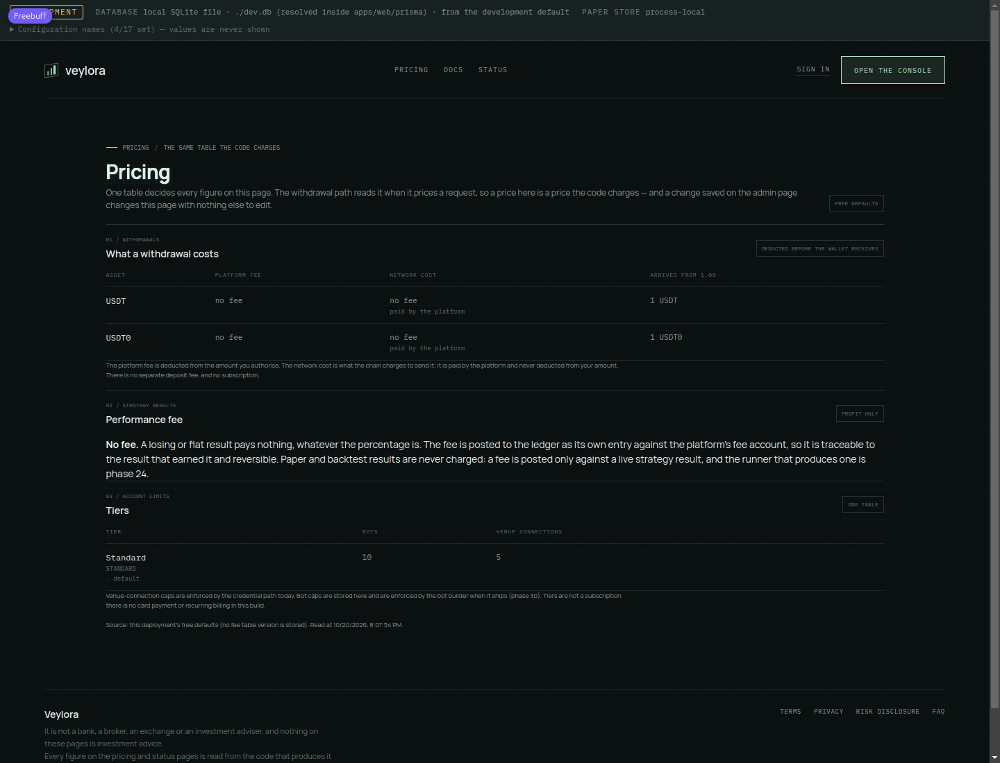
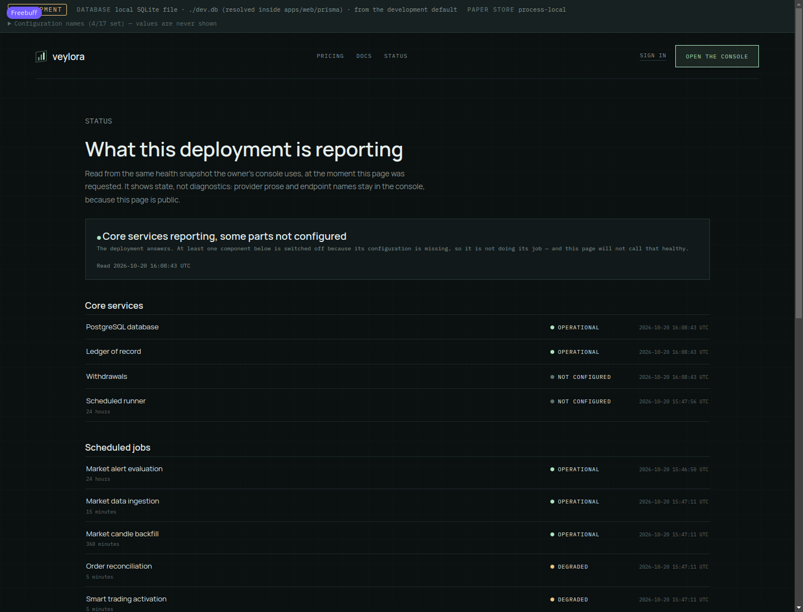

# Phase 40 — public pages, environment parity and launch

Measured on the working tree 2026-10-20, node v24.21.0, pnpm 11.15.1, from `apps/web`. Everything
below is a command that was run or an output that was read; where a step needs the hosted project it
says so instead of implying it happened.

## What this phase adds

Nine public pages in the `(public)` route group — `/`, `/pricing`, `/status`, `/docs`, `/docs/api`,
`/terms`, `/privacy`, `/risk`, `/faq` — none of which needs a session. `/pricing` renders the fee
table the code charges, `/status` renders the health snapshot the owner's console uses, and the legal
pages repeat one shared set of not-statements so no page can claim more than another.

Supporting work: `pnpm env:parity` (three scopes compared, every difference named, plus the required
names a scope-to-scope comparison cannot see), a route-inventory update for the group and the moved
console home, CI steps for parity / plan validation / a committed-`.env` check, the deploy order
asserted by test, and `plan/OWNER_RUNBOOK.md` executed once.

## Defects found after the phase, and repaired

Running the browser suite on the final tree — which this phase had not done — found that the route
move left three things behind: sign-in navigated to `/` (now the landing page) instead of `/terminal`,
the login page's "back" link pointed at the console a signed-out visitor cannot open, and the E2E
journey still asserted the old path. All three are fixed and covered by a new test; the suite also
now clears its own stale `.next/dev` before starting, because inheriting it made all five specs fail at
sign-in. See [`todo-verification-2026-10-20.md`](todo-verification-2026-10-20.md) §4.

## The pages, on the running app

Started with `NODE_ENV=development npx next dev -p 3410` against the seeded SQLite database.

```
200 /           47956 bytes
200 /pricing    49158 bytes
200 /status     61223 bytes
200 /docs       43898 bytes
200 /terms      53642 bytes
200 /faq        50736 bytes
200 /risk       47060 bytes
200 /privacy    52071 bytes
200 /docs/api   95985 bytes
```





**The pricing page is the fee table, verified by drifts.** The deployment had no stored version, so
the page said `FREE DEFAULTS` and rendered the defaults (USDT and USDT0, `no fee`, `1 USDT` arriving
from 1.00). A version was then written through the same writer `/admin/fees` uses
(`saveFeeSchedule`, USDT 1.5 / network 0.5 / performance 20%) and the page reloaded **without a
restart**:

```
source: owner-schedule, version 2026-10-20T16:05:55.453Z
row: feeLabel "1.5 USDT", networkCostLabel "0.5 USDT"
page shows the stored fee: true
page shows OWNER-SET TABLE: true
page shows 20% performance fee: true
after deleting that version: FREE DEFAULTS again
```

That is the phase's "cannot drift" criterion executed: the page has no amount of its own.

**The status page is the health snapshot.** Core services read `PostgreSQL database OPERATIONAL`,
`Ledger of record OPERATIONAL`, `Withdrawals NOT CONFIGURED`, `Scheduled runner NOT CONFIGURED`; the
eleven scheduled jobs each rendered with cadence and last-ran time (`Market alert evaluation
OPERATIONAL 24 hours`, `Order reconciliation DEGRADED 5 minutes`, …).

### Two defects the screenshots found

1. **The pricing tables had no styling.** They used `market-table`, a class that does not exist in
   `globals.css`, so the columns ran together — `USDTno fee no feeno fee paid by the platform1 USDT`.
   Fixed by adding `.public-table` / `.public-table-wrap` (left-aligned, wrapping, 8/11/12px mono)
   and switching the page to them. The console's `.market-history-table` was rejected on purpose: it
   is right-aligned and `nowrap`, which suits a ticker and ruins a sentence.
2. **The status summary overclaimed.** With the runner and withdrawals unconfigured, the headline
   read *"All core services reporting"* — true in the weak sense that `unconfigured` is an answer,
   and exactly the kind of comfort this page exists to avoid. It now says *"Core services reporting,
   some parts not configured"* with a note that the component is switched off and is not doing its
   job.

## Environment parity

`pnpm env:parity` reads `plan/ENVIRONMENT_MANIFEST.txt` (names only; host read 2026-10-15). 354
scope entries / 179 distinct names: Development 167, Preview 170, Production 179. Production holds
21 names the other scopes do not, and all 21 are declared with a reason — the full table is in
`plan/PROJECT_TODO.md` §Phase 40 and `apps/web/README.md`. The four kinds:

- development's own secrets and SQLite file (4 gaps),
- a stale name, `CREDENTIAL_ENCRYPTION_KEY`, which this build never reads (2 gaps),
- `CRON_SECRET` in Preview, deliberately absent so a preview cannot drive the runner against the
  shared database (1 gap),
- six names configured in Production and read by nothing in this build —
  `COMPLIANCE_PROVIDER`, `CUSTODY_PROVIDER`, `CUSTODY_KEY_ID`, `OWNER_WALLET_ADDRESSES` and the three
  server-side `WALLET_RPC_URL_*` (14 gaps).

**The finding worth the phase:** scope-to-scope comparison cannot see a name that is missing
everywhere. `REQUIRED_NAMES` closes that, and it reports **ten unconfirmed**:
`APP_BASE_URL`, `AUTH_EVM_CHAIN_IDS`, `TRADING_CREDENTIAL_ENCRYPTION_KEY` and
`INITIAL_ADMIN_EVM_ADDRESS` in Preview and Production; `DEPOSIT_ADDRESS_MNEMONIC` and
`WITHDRAWAL_HOT_WALLET_MNEMONIC` in Production. Sign-in is closed without the first two and no venue
credential or TOTP secret can be stored without the third, so `--strict` must be cleared in the
host's project settings before publishing. It is not evidence of an outage — the manifest records
names, not values — and the tool says so rather than asserting one.

```
$ node scripts/env-parity.mjs --check
Parity: OK — every Production variable is present in the other scopes, or its absence is declared.
Required names: 10 unconfirmed by the manifest — resolve them in the host's project settings.
$ echo $?          → 0
$ node scripts/env-parity.mjs --strict ; echo $?   → 1
```

## Deploy order, and the failure that must stop it

`build:vercel` is `prisma migrate deploy && next build`. `tests/deploy-procedure.test.ts` asserts the
order, that the two are joined by `&&` and nothing else, that both go through
`with-neon-env.mjs`, that `vercel.json`'s cron path resolves to a real route, and — executed, not
read — that `false && echo BUILD-RAN` prints nothing.

The manual failure case, against a scratch Postgres 18 database with a deliberately broken migration
(`ALTER TABLE "NoSuchTable" ADD COLUMN "mistake" INTEGER;`):

```
$ DATABASE_URL=… node scripts/with-neon-env.mjs prisma migrate deploy --schema … && echo BUILD-STARTED
Migration name: 20261021000000_deliberate_failure
Database error code: 42P01
ERROR: relation "NoSuchTable" does not exist
chain_exit=1          (BUILD-STARTED never printed)
```

The row stays in `_prisma_migrations` with `finished_at` null, so the next deploy refuses until it
is resolved — which is what `plan/OWNER_RUNBOOK.md` §7 tells the owner.

**The migrations had never been applied to Postgres in this project.** They have now: all 18 applied
cleanly to a fresh Postgres 18 cluster (`All migrations have been successfully applied.`).

## The runbook, executed

`plan/OWNER_RUNBOOK.md` was followed on a scratch cluster and the development database. Executed:

| step | result |
| --- | --- |
| migrate a fresh database | 18/18 applied, exit 0 |
| seed through the real writers | 2 users, 4 ledger accounts, 1 transaction, 2 balanced entries (250000000 debit = 250000000 credit), 5 audit events |
| `pg_dump -Fc` | 194 KB, 0.21 s |
| `pg_restore --exit-on-error` into a new database | exit 0, 69 tables |
| inspect the restored copy | identical counts, identical balance, `ok: true`, head hash `ce7e14ca…` |
| **destroy** the database (`drop schema public cascade`) | 69 objects dropped, **0 tables** |
| restore into it again | exit 0, 69 tables back |
| `pnpm audit:verify` on the restored database | `ok: true, checked: 5, chainLength: 5, headHash ce7e14ca…` |
| pause trading | `killSwitchActive true`, `KILL_SWITCH_ENGAGED` at chain index 11, attributed with a timestamp |
| restart the runner | two invocations (`3c1eac6c…`, `c7883665…`), both `idle`, `jobsDue 0 / jobsSkipped 11`, each job printing its own `nextDueAt` |
| resume | `KILL_SWITCH_RELEASED` at chain index 13, `killSwitchActive false` |

Not executed, and named as such in the runbook: any deploy to Preview or Production, a Neon restore,
and the rotation of a live provider key. The drift check also left the development database as it
found it (the fee version was deleted, the kill switch released, the runner rows are ordinary
heartbeats).

## Gates

| gate | command | result |
| --- | --- | --- |
| typecheck | `pnpm typecheck` | exit 0 |
| test | `pnpm test` | exit 0 — **787 tests, 787 pass, 0 fail, 0 skipped** (772 before this phase; the 15 new ones are below) |
| lint | `pnpm lint` | exit 0 |
| build | `pnpm build` | exit 0 — **31 page routes** (was 24), 131 exported API methods |
| parity | `node scripts/env-parity.mjs --check` | exit 0; `--strict` exit 1 on the ten unconfirmed names |
| plan | `node scripts/validate_plan.mjs` | exit 0 — 40 phase files, index 40, 0 restriction hits, 0 warnings |

New tests this phase: `tests/public-pages.test.ts` (4 — no session, no unbackable claim, pricing is
the table, the legal pages name the operator), `tests/deploy-procedure.test.ts` (4),
`scripts/env-parity.test.mjs` (7). The route-inventory tests were updated for the group and the
moved console home, and `pagePathFromFile` now drops route-group segments so the sweep probes the
addresses the app serves.

## Findings, in the order they would bite

1. **Ten required names are unrecorded** (`--strict`), four of them sign-in and encryption. Launch
   blocker until the owner checks the host's project settings.
2. **`CREDENTIAL_ENCRYPTION_KEY` is stale.** Production holds a name this build never reads; the
   vault wants `TRADING_CREDENTIAL_ENCRYPTION_KEY`. Declared, not copied, so it stays visible.
3. **Six Production-only names are read by nothing.** Deleted or wired is the owner's call; their
   absence elsewhere cannot break anything, which is why they are declared rather than added.
4. **The tables in the pricing page were unstyled**, and the status headline overclaimed. Both fixed
   and re-photographed.
5. **`market-table` was referenced by the new page and defined nowhere** — a class name that looks
   like it exists is the kind of defect a typecheck cannot catch, which is why the browser reading
   was part of this phase rather than an afterthought.

## Definition of done

- [x] Public pages render from real state, with a test asserting pricing matches the fee table.
- [ ] Legal and risk text signed off by the owner — written, and every page names the operator and
      the not-statements; the sign-off is the owner's, and `/terms` says no jurisdiction is named.
- [x] Parity across the three environments documented, every difference named.
- [x] The runbook executed once, including a verified restore.
- [ ] Published — not done, and not to be done without the owner's explicit go-ahead.
